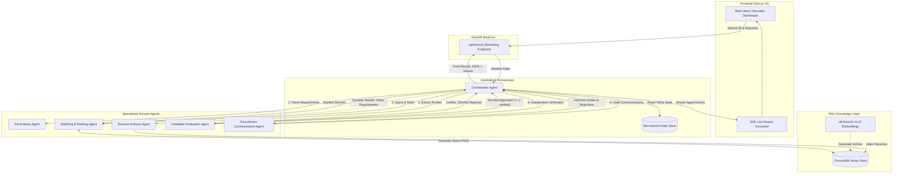
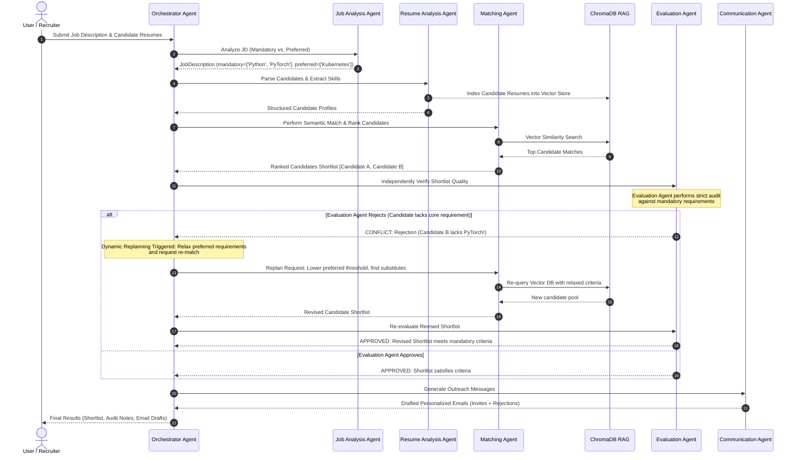

# TalentAI — Architecture Diagram & System Workflow

This document details the multi-agent architectural topology, message flow, and dynamic replanning sequence for **TalentAI**.

---

## 1. Multi-Agent Pipeline Topology

---

## 2. Dynamic Conflict Resolution & Replanning Sequence

---

## 3. Communication Pattern Summary

| Step | Sender | Receiver | Payload / Message Type | Purpose |
|------|--------|----------|------------------------|---------|
| 1 | Orchestrator | Job Analysis Agent | Raw Job Text | Extract required & preferred technical qualifications |
| 2 | Orchestrator | Resume Analysis Agent | Raw Resumes List | Structured extraction and vector indexing |
| 3 | Orchestrator | Matching Agent | `JobDescription` + candidate pool | Vector RAG retrieval and composite scoring |
| 4 | Orchestrator | Evaluation Agent | Shortlisted Candidates + `JobDescription` | Independent scrutiny and validation |
| 5 | Evaluation Agent | Orchestrator | `APPROVED` or `REJECTED` + conflict explanation | Quality gate / challenge to Matching Agent |
| 6 | Orchestrator (Replan) | Matching Agent | Revised search parameters | Dynamic replanning on conflict or low candidate count |
| 7 | Orchestrator | Communication Agent | Final evaluated shortlist | Automated tailored outreach email generation |
